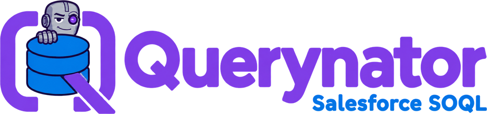
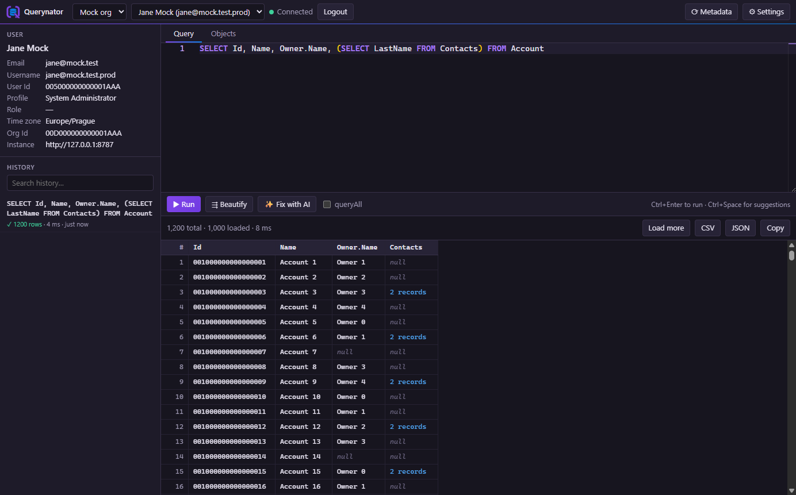
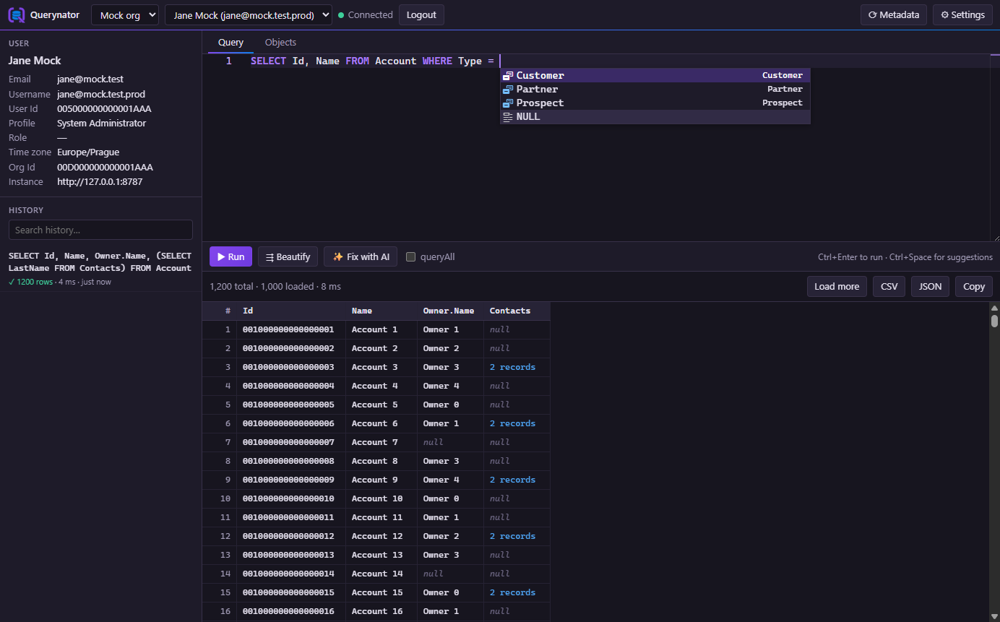
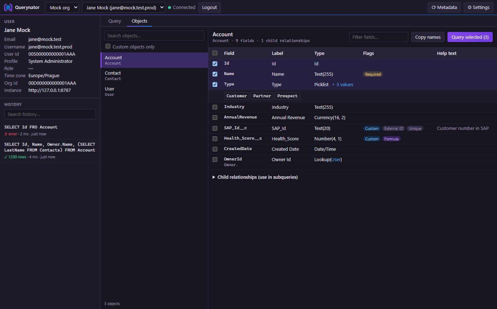
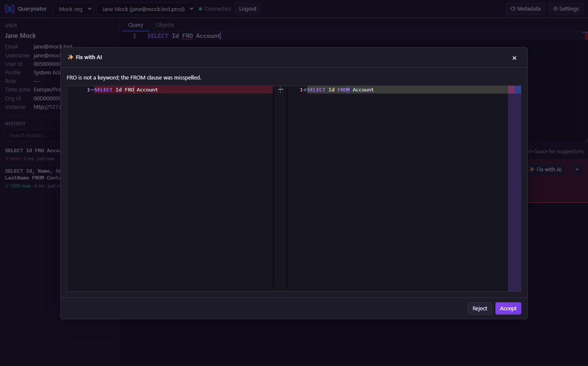

<p align="center">
  
</p>

<p align="center">Desktop SOQL client for Salesforce — Windows, macOS and Linux.</p>



## Features

- **Salesforce OAuth**, **Azure AD SSO** or a **pasted access token**, several environments, several users per environment
- **SOQL editor** with highlighting, Beautify and context-aware autocomplete (fields, relationships, picklists, date literals)
- **Results grid** with Load more, subquery drill-down and CSV / JSON / clipboard export
- **Objects tab** to browse objects, fields, picklist values and child relationships
- **Fix with AI** (OpenAI) with a side-by-side diff
- **Query history**, User card, environment import/export

| Autocomplete | Objects | Fix with AI |
|---|---|---|
|  |  |  |

## Setup

Open **⚙ Settings → Add environment** (or **Import…** a JSON export) and pick the **Authentication**:

**Salesforce OAuth (Connected App)** — for any org. Create a Connected App or External Client App with OAuth enabled,
callback URL `http://localhost:1717/oauth/callback`, **Require PKCE**, and the `api` + `refresh_token` scopes. Then fill in:

| Field | Example |
|---|---|
| Login URL | `https://login.salesforce.com`, `https://test.salesforce.com` or your My Domain |
| Consumer Key | from the app |
| Callback URL | same as in the app (nothing listens there — the app window catches the redirect) |
| Client secret | only if the app requires it |

**Access token (paste)** — no login flow: set the **Instance URL** (e.g. `https://yourorg.my.salesforce.com`);
**Login** then asks for an access token, e.g. the "Access Token" from `sf org display --target-org <alias>`. It's stored
encrypted and used until it expires.

**Azure SSO → token service** — for orgs behind a service that issues Salesforce tokens for Azure AD tokens:

| Field | Example |
|---|---|
| Auth URL / Token URL | `https://login.microsoftonline.com/<tenant>/oauth2/v2.0/authorize` · `…/token` |
| Client ID, Scope | Azure app registration id, `api://<your-api>/<scope> …` |
| Callback URL | `msauth://<bundle-id>/<signature>` — must match the Azure app registration |
| SF token URL | Service that returns a Salesforce token for an Azure token (`Authorization: Bearer <Azure token>`) |

For **Fix with AI**, add an OpenAI API key and model in the same dialog.

Both logins use the authorization code flow with PKCE in an app window. Tokens renew automatically, refresh tokens and
keys are encrypted with the OS keychain, and exports never contain secrets.

## Install

Download the installer for your system from the **[latest release](https://github.com/mejmo/sf-querynator/releases/latest)**:

- **Windows** — `Querynator Setup x.y.z.exe`. If SmartScreen warns, click **More info → Run anyway**.
- **macOS** — `Querynator-x.y.z-arm64.dmg` (Apple Silicon) or `Querynator-x.y.z.dmg` (Intel).
  [How to open an app from an unidentified developer](https://support.apple.com/guide/mac-help/open-a-mac-app-from-an-unidentified-developer-mh40616/mac)
- **Linux** — `querynator_x.y.z_amd64.deb` (`sudo apt install ./querynator_*.deb`) or the `.AppImage` (`chmod +x`, then run).

All versions: [Releases](https://github.com/mejmo/sf-querynator/releases)

## Development

Requires Node 20.19+ or 22.12+.

```bash
npm install
```

```bash
npm run dev
```

| Script | |
|---|---|
| `npm test` / `npm run typecheck` | Vitest unit tests / TypeScript check |
| `npm run build` | Build into `out/` |
| `npm run dist:win` · `dist:linux` · `dist:mac` | Installers (Linux via Docker on Windows; macOS on a Mac) |

```
src/soql/       SOQL tokenizer, cursor context, completions, flatten, export, beautify
src/main/       Electron main: Azure/Salesforce/OpenAI clients, encrypted stores, IPC
src/renderer/   React UI + Monaco
tests/          Vitest
scripts/        mock Azure + Salesforce server for smoke tests
```

**Windows code signing** (optional, Azure Artifact Signing): add repository secrets `AZURE_TENANT_ID`,
`AZURE_CLIENT_ID`, `AZURE_CLIENT_SECRET` (an app registration with the *Artifact Signing Certificate Profile Signer*
role) and repository variables `AZURE_SIGNING_ENDPOINT`, `AZURE_SIGNING_ACCOUNT`, `AZURE_SIGNING_PROFILE`,
`AZURE_SIGNING_PUBLISHER` (the certificate's CN). Release builds are then signed; without them they stay unsigned.

**Smoke test without an org:** run `node scripts/mock-salesforce.mjs 8787`, create `<profile>/settings.json` with the
environment from `scripts/mock-environment.json` (plus an `id`), then run
`QN_USER_DATA=<profile> QN_SMOKE=<dir> QN_OPENAI_URL=http://127.0.0.1:8787/v1/chat/completions npx electron-vite preview`
after `npm run build`. It clicks through the whole app and saves screenshots to `<dir>`.

App data lives in the OS app-data folder (`%APPDATA%\Querynator` on Windows).

## License

[MIT](LICENSE) © DevelMagic s.r.o.
